# Práctica 1: Instalación, configuración y control de acceso

**Por: Iván Arévalo Aznar**

- **Rol:** DBA  
- **SGBD Elegido:** PostgreSQL  
- **Entorno de despliegue:** Docker  

---

## 1. Análisis del Escenario y Planificación
Somos el DBA de la empresa VAPOR, una consultora tecnológica especializada en la convergencia segura entre los entornos OT (Operational Technology) e IT (Information Technology) para pymes manufactureras. 

La empresa tiene una aplicación de gestión (ERP) y un equipo de personas que trabajan con la base de datos de la empresa. Nos han encargado desplegar un único servidor que pueda atender a todos los empleados, controlar quien accede y que puede hacer. 

### 1.1 Requisitos y parámetros de cálculo:
- **Límite de RAM del servidor:** 2 GB (`2g`)
- **Conexiones ERP:** 3 instancias × 15 conexiones = 45 conexiones simultáneas mínimas para ERP.
- **Conexiones RRHH:** Conexiones estimadas para intranet pequeña.
- **Red permitida:** `172.30.0.0/24` (Aplicación).
- **Red bloqueada:** `172.31.0.0/24` (Visitantes).
- **Límite de espacio ERP:** [100 MB si es Oracle / N/A si es PostgreSQL]


### 1.2 Tabla resumen del proyecto

| Requisito | Cómo se ha resuelto | Evidencia |
| --- | --- | --- |
| **1. Despliegue reproducible** | Docker Compose con versión fija (`16.2-alpine`), volúmenes separados y `setup-env.sh`. | Apartado 2.1 y 3.1 |
| **2. Acceso a red interna** | Dos redes Docker y reglas `reject` en `pg_hba.conf` para la red de visitantes. | Apartado 2.1, 2.3 y 3.2 |
| **3. Memoria** | Configuración de `shared_buffers = 512MB` y `work_mem = 10MB` ajustado a los 2 GB de RAM. | Apartado 2.2 y 3.3 |
| **4. Conexiones** | Límite global `max_connections = 60` calculado para las instancias ERP y personal. | Apartado 2.2 y 3.4 |
| **5. Almacenamiento** | Creación de tablespaces separados para ERP y RRHH sobre volúmenes persistentes. | Apartado 2.1 y 3.5 |
| **6. Trazabilidad** | Activación de `logging_collector` redirigido al volumen persistente de logs (`pg_logs`). | Apartado 2.2 y 3.6 |
| **7. Cuenta de la aplicación** | Usuario propietario y de conexión con privilegios limitados y contraseña sin caducidad. | Apartado 3.7 |
| **8. Acceso del personal** | Cuentas individuales, roles por perfiles, vistas sin salarios y caducidad de 90 días. | Apartado 3.8 |
| **9. Ampliación: caída repentina** | Política `restart: always` en Docker Compose y recuperación de transacciones mediante WAL. | Apartado 2.1 y 3.9 |
|


## 2. Creación de la estructura
En este apartado explicaremos que hacen cada uno de los archivos de nuestro repositorio, y le daremos un sentido a toda la estructura. 

### 2.1 Configuración Docker Compose
Nos aseguramos que nuestro servidor sea desplegable en todo momento y que no se pierdan datos. La manera de conseguir este objetivo es mediante un docker compose en el que asignemos volúmenes y una versión fija de cada imagen.

```docker
networks:
  net_app:
    driver: bridge
    ipam:
      config:
        - subnet: 172.30.0.0/24
  net_visitors:
    driver: bridge
    ipam:
      config:
        - subnet: 172.31.0.0/24

volumes:
  pg_sys_data:
  pg_erp_data:
  pg_rrhh_data:
  pg_logs:

services:
  db_server:
    image: postgres:16.2-alpine  # Versión fija 
    container_name: postgres_db
    restart: always              # Configuración contra caídas (Requisito 9)
    environment:
      POSTGRES_USER: ${POSTGRES_USER}
      POSTGRES_PASSWORD: ${POSTGRES_PASSWORD}
      POSTGRES_DB: ${POSTGRES_DB}
    volumes:
      # Datos del sistema
      - pg_sys_data:/var/lib/postgresql/data
      # Volúmenes separados de ERP y RRHH (Tablespaces)
      - pg_erp_data:/mnt/tablespaces/erp
      - pg_rrhh_data:/mnt/tablespaces/rrhh
      # Log persistente
      - pg_logs:/var/log/postgresql
      # Archivos de configuración personalizada.
      - ./postgresql.conf:/etc/postgresql/postgresql.conf:ro
      - ./pg_hba.conf:/etc/postgresql/pg_hba.conf:ro
    command: >
      postgres 
      -c config_file=/etc/postgresql/postgresql.conf
      -c hba_file=/etc/postgresql/pg_hba.conf
    deploy:
      resources:
        limits:
          memory: 2048M         # Límite de 2 GB de RAM
    networks:
      - net_app
      - net_visitors
    # Sin ports publicados al host

  # Cliente de prueba de la red de aplicación
  client_app:
    image: postgres:16.2-alpine
    container_name: client_app
    entrypoint: ["sleep", "infinity"]
    networks:
      - net_app

  # Cliente de prueba de la red de visitantes
  client_visitor:
    image: postgres:16.2-alpine
    container_name: client_visitor
    entrypoint: ["sleep", "infinity"]
    networks:
      - net_visitors
```
  
### 2.2 Archivos de configuración PostgreSQL
A continuación, crearemos un archivo de configuración que gestionará parámetros internos de nuestra base de datos, tales como el número de conexiones y la memoria RAM asignada para cada proceso.

Con 2 GB totales, dedicamos 512 MB a memoria compartida (`shared_buffers`), calculando las reservas por operación (`work_mem × max_connections = 10MB × 60 = 600MB` en el peor caso teórico concurrente), dejando margen libre suficiente para el sistema operativo y la caché del sistema (`effective_cache_size = 1280MB`).

```ini
# --- CONEXIONES (Requisito 4) ---
max_connections = 60
listen_addresses = '*'

# --- MEMORIA (Requisito 3) ---
# Memoria compartida
shared_buffers = 512MB
effective_cache_size = 1280MB

# Memoria por proceso
work_mem = 10MB
maintenance_work_mem = 64MB

# --- LOGS (Requisito 6) ---
logging_collector = on
log_destination = 'csvlog'
log_directory = 'log'
log_filename = 'postgresql-%Y-%m-%d_%H%M%S.log'
log_connections = on
log_disconnections = on
```


### 2.3 Configuración de redes del contenedor (pg_hba.conf)
Configuramos qué conexiones pueden acceder a nuestro servidor de bases de datos y cuáles prohibimos.

```bash
# TYPE  DATABASE        USER            ADDRESS                 METHOD

# Conexiones locales de mantenimiento dentro del mismo contenedor
local   all             all                                     trust

# Permitir conexiones SÓLO desde la red de aplicación (172.30.0.0/24)
host    all             all             172.30.0.0/24           md5

# Rechazar explícitamente cualquier intento desde la red de visitantes (172.31.0.0/24)
host    all             all             172.31.0.0/24           reject

# Rechazar cualquier otra conexión
host    all             all             all                     reject
```
---

### 2.4 Archivo .env
En este archivo guardaremos el usuario y la contraseña a nuestra base de datos.

```env
POSTGRES_USER=admin_ivan
POSTGRES_PASSWORD=ivan!1234
POSTGRES_DB=postgres
```
--- 

### 2.5 Script de automatización (`setup-env.sh`)
Para automatizar la inicialización del entorno y garantizar que la base de datos se configure de forma limpia y reproducible cada vez que se despliega el contenedor, utilizamos un script auxiliar que carga las variables de entorno y ejecuta los ficheros de inicialización SQL.

```bash
#!/usr/bin/env bash
set -euo pipefail
cd "$(dirname "$0")"

echo "=== Arrancant els contenidors amb Docker Compose ==="
docker compose up -d
sleep 10

echo "=== Assegurant permisos als directoris de tablespaces ==="
docker exec -u root postgres_db mkdir -p /mnt/tablespaces/erp /mnt/tablespaces/rrhh
docker exec -u root postgres_db chown -R postgres:postgres /mnt/tablespaces


echo "=== Executant scripts d'inicialització SQL ==="
docker exec -i postgres_db psql -U ${POSTGRES_USER:-admin_ivan} -d ${POSTGRES_DB:-postgres} < sql/01-tablespaces.sql
docker exec -i postgres_db psql -U ${POSTGRES_USER:-admin_ivan} -d ${POSTGRES_DB:-postgres} < sql/02-usuaris-rols.sql
docker exec -i postgres_db psql -U ${POSTGRES_USER:-admin_ivan} -d ${POSTGRES_DB:-postgres} < sql/03-dades-prova.sql

echo "=== Desplegament completat amb èxit! ==="
```

---

### 2.6 Scripts de Inicialización SQL (init.sql)

Estos tres archivos centralizan la creación de tablas, tablespaces, roles y funciones automatizadas que se ejecutan durante la puesta en marcha del sistema:

```SQL
-- ==========================================================
-- ARCHIVO 1. CREACIÓN DE TABLESPACES Y BASES DE DATOS (Apartado 3.5)
-- ==========================================================
-- Nota: Los directorios físicos deben estar previamente mapeados en Docker
CREATE TABLESPACE erp_ts LOCATION '/mnt/tablespaces/erp';
CREATE TABLESPACE rrhh_ts LOCATION '/mnt/tablespaces/rrhh';

-- ==========================================================
-- ARCHIVO 2. CONFIGURACIÓN DE ROLES Y CUENTAS DE APLICACIÓN (Apartado 3.7)
-- ==========================================================
-- Rols globals
CREATE ROLE rol_rrhh;
CREATE ROLE rol_analistes;

-- ERP
CREATE USER erp_owner PASSWORD 'erp_owner_pass' VALID UNTIL 'infinity';
CREATE USER erp_user WITH PASSWORD 'erp_password_123' CONNECTION LIMIT 45 VALID UNTIL 'infinity';

-- Funció d'automatització de 90 dies
CREATE OR REPLACE FUNCTION afegir_personal(p_usuari TEXT, p_password TEXT, p_rol TEXT)
RETURNS VOID AS $$
DECLARE
    v_caducitat TIMESTAMP;
BEGIN
    v_caducitat := CURRENT_TIMESTAMP + INTERVAL '90 days';
    EXECUTE format('CREATE USER %I PASSWORD %L VALID UNTIL %L', p_usuari, p_password, v_caducitat);
    EXECUTE format('GRANT %I TO %I', p_rol, p_usuari);
END;
$$ LANGUAGE plpgsql;

-- Crear el personal inicial
SELECT afegir_personal('usuari_rrhh1', 'rrhh1_pass', 'rol_rrhh');
SELECT afegir_personal('usuari_analista1', 'analista1_pass', 'rol_analistes');


-- ==========================================================
-- ARCHIVO 3. GESTIÓN DE USUARIOS Y ROLES DE PERSONAL (Apartado 3.8)
-- ==========================================================
-- Taula d'empleats a l'espai de RRHH
CREATE TABLE empleats (
    id SERIAL PRIMARY KEY,
    nom VARCHAR(50),
    departament VARCHAR(50),
    salari NUMERIC(10, 2)
) TABLESPACE tbs_rrhh;

-- Inserció de dades de prova
INSERT INTO empleats (nom, departament, salari) VALUES 
('Anna Garcia', 'RRHH', 2500.00),
('Joan Puig', 'IT', 3000.00);

-- Vista per a analistes que amaga la columna de salaris (Requisit 8)
CREATE VIEW vista_empleats_sense_salari AS 
SELECT id, nom, departament 
FROM empleats;

-- Atorgar permisos al rol d'analistes només sobre la vista (i no sobre la taula original amb salaris)
GRANT SELECT ON vista_empleats_sense_salari TO rol_analistes;
GRANT SELECT, INSERT, UPDATE, DELETE ON TABLE empleats TO rol_rrhh;

CREATE TABLE erp_comandes (
    id SERIAL PRIMARY KEY,
    article VARCHAR(100),
    quantitat INT
) TABLESPACE tbs_erp;

ALTER TABLE erp_comandes OWNER TO erp_owner;
GRANT SELECT, INSERT, UPDATE, DELETE ON erp_comandes TO erp_user;
GRANT USAGE, SELECT ON SEQUENCE erp_comandes_id_seq TO erp_user;
```


## 3. Demostraciones

### 3.1 Persistencia tras reinicio
Ejecutamos los siguientes comandos para comprobar la persistencia:
```bash
# 1. Iniciar entorno y crear una tabla de prueba
docker compose up -d
docker exec -it postgres_db psql -U admin_ivan -d postgres -c "CREATE TABLE prova_persistence (id int);"

# 2. Destruir completamente el contenedor (sin borrar volúmenes)
docker compose down

# 3. Volver a crear el servidor
docker compose up -d

# 4. Comprobar que los datos siguen allí
docker exec -it postgres_db psql -U admin_ivan -d postgres -c "SELECT * FROM prova_persistence;"
```
\
Probamos a levantar el contenedor y creamos una tabla.

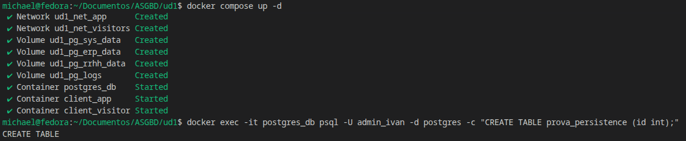

Después, comprobamos que la tabla sigue existiendo (Si la tabla no existiese, nos saldría un error.)

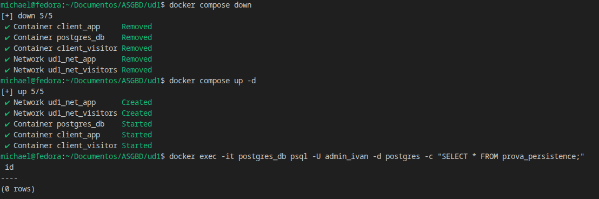

---

### 3.2 Comprobar política de conexiones
Ejecutamos los siguientes comandos para confirmar que acepte las conexiones desde client_app y rechace las de client_visitor.

Gracias al archivo `pg_hba.conf`, las conexioenes desde client_app son aceptadas y las conexiones desde client_visitor son denegadas. 

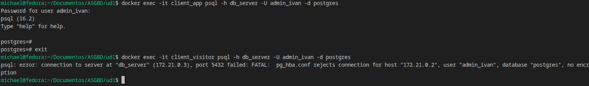

---

### 3.3 Comprobar memoria
Con 2 GB totales, dedicamos 512 MB a memoria compartida (`shared_buffers`), calculando las reservas por operación (`work_mem × max_connections = 10MB × 60 = 600MB` en el peor caso teórico concurrente), dejando margen libre suficiente para el sistema operativo y la caché del sistema (`effective_cache_size = 1280MB`).

Comprobación de parámetros:
- **Parámetro modificable en caliente (`work_mem`, en `postgresql.conf`):** Permite ajustar la memoria por operación de clasificación o hash por sesión sin necesidad de reiniciar el servicio.
  - *Comprobación:* Podemos ejecutar `ALTER SYSTEM SET work_mem = '16MB';` y recargar la configuración con `SELECT pg_reload_conf();`, consultando posteriormente el resultado con `SHOW work_mem;`.

  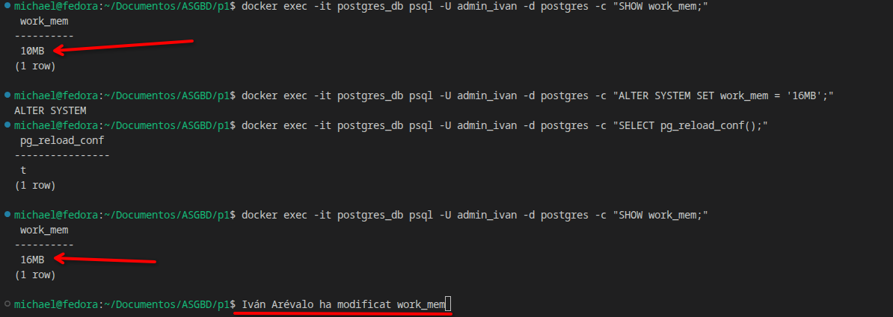

- **Parámetro que requiere reinicio (`shared_buffers`):** Define la memoria compartida de PostgreSQL para la caché de datos. Si se modifica mediante `ALTER SYSTEM`, el valor en uso no se aplica hasta que se reinicia el contenedor de Docker (`docker compose restart db_server`).

  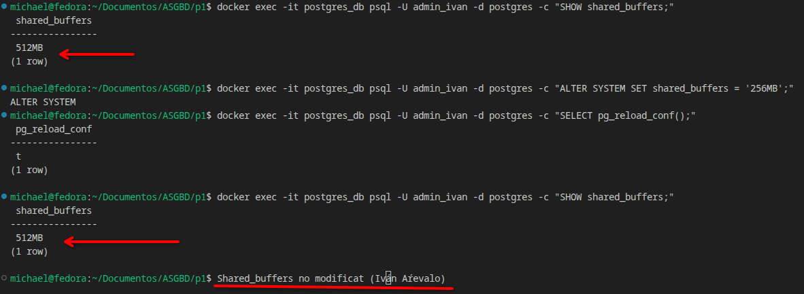


---

### 3.4 Comprobar conexiones

- Hemos configurado `max_connections = 60` en el archivo `postgresql.conf`. Este valor está dimensionado para soportar la aplicación ERP, los analistas, el personal de RRHH y las tareas de mantenimiento sin agotar los recursos del sistema host.
- Si intentamos abrir conexiones de manera masiva superando este límite (o el límite específico asignado a las cuentas de aplicación), el servidor rechaza nuevas conexiones devolviendo un error de tipo `FATAL: sorry, too many clients already`.
- Filtrado y control en `pg_hba.conf`: El control de acceso basado en el origen de la red (`host` con subredes específicas `172.30.0.0/24` y reglas de rechazo `reject` para redes no autorizadas como la de visitantes) asegura que solo los clientes legítimos puedan establecer la conexión TCP.

Para demostrar la configuración, bajaremos temporalmente el límite a 5 conexiones con el objetivo de saturar el servidor fácilmente y mostrar el error.

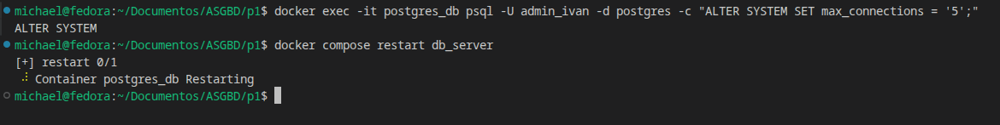

A continuación, abrimos terminales o sesiones concurrentes hasta que alcanzamos el error de `too many clients`:

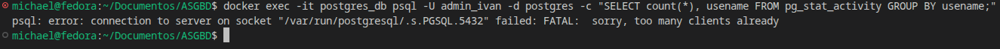

---

### 3.5 Comprobar almacenamiento y tablespaces
Primero nos aseguramos de que el usuario `postgres` tenga acceso a los tablespaces. Para ello, entraremos en el servidor y usaremos el comando `chown postgres:postgres -R /mnt/tablespaces`.

Una vez hecho, crearemos los dos tablespaces, ERP y RRHH.

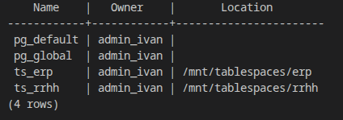

Después, creamos las bases de datos y revisamos que estén asociadas a sus respectivos tablespaces:

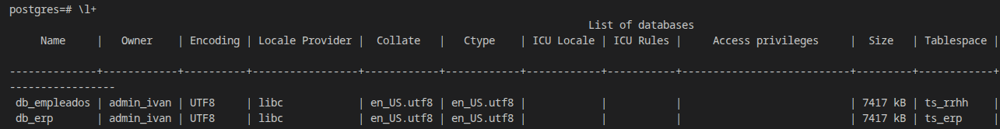

Reiniciamos y comprobamos que los tablespaces y las bases de datos se mantienen correctamente:

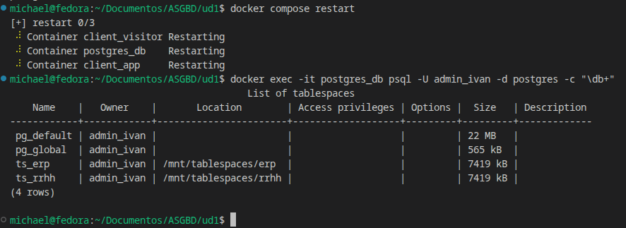

---

### 3.6 Trazabilidad (Logs)
Gracias a la configuración del `logging_collector` activada en `postgresql.conf` y mapeada al volumen persistente `pg_logs`, todos los intentos de conexión (así como los bloqueos de la red de visitantes definidos en `pg_hba.conf`) quedan registrados de manera permanente dentro del directorio de logs del contenedor, resistiendo a la destrucción del mismo.

Podemos comprobarlo ejecutando: 
```bash
docker exec -it postgres_db sh -c "tail -n 2 /var/log/postgresql/log/\$(ls -t /var/log/postgresql/log/ | grep '\.csv' | head -n 1)"
```

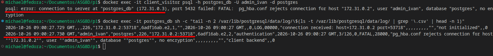

---

### 3.7 Cuenta de la aplicación

Para cumplir con los requisitos de seguridad del ERP, hemos separado claramente los roles de propiedad de los datos y los roles de conexión de la aplicación:

- **Usuario Propietario (`erp_owner`):** Es el propietario de las tablas y del espacio de almacenamiento del ERP, pero **nadie se conecta directamente** con él para operaciones rutinarias.
- **Usuario de Conexión (`erp_user`):** Es la cuenta que utiliza la aplicación ERP para acceder a la base de danych. Tiene un límite estricto de **45 conexiones** (calculadas a partir de las 3 instancias × 15 conexiones del escenario) y su contraseña está configurada para **no caducar nunca** (`VALID UNTIL 'infinity'`).

#### Configuración y permisos (Archivos SQL)
Dentro de los archivos 02-usuaris-rols.sql y 03-dades-prova.sql, nos encontramos la configuración que define los usuarios y el límite de conexiones.

```sql
-- 1. Crear el usuario propietario de los datos del ERP (sin caducidad)
CREATE USER erp_owner PASSWORD 'erp_user_pass' VALID UNTIL 'infinity';

-- 2. Crear el usuario de conexión de la aplicación con límite de 45 conexiones y sin caducidad
CREATE USER erp_user WITH PASSWORD 'erp_password_123' CONNECTION LIMIT 45 VALID UNTIL 'infinity';

-- 3. Crear tabla del ERP asignada al tablespace correspondiente
CREATE TABLE erp_comandes (
    id SERIAL PRIMARY KEY,
    article VARCHAR(100),
    quantitat INT
) TABLESPACE erp_ts;

-- 4. Asignar la propiedad al propietario y permisos estrictos de DML (sin DDL) al usuario del ERP
ALTER TABLE erp_comandes OWNER TO erp_owner;
GRANT SELECT, INSERT, UPDATE, DELETE ON erp_comandes TO erp_user;
GRANT USAGE, SELECT ON SEQUENCE erp_comandes_id_seq TO erp_user;
```
\
Comprobamos que el usuario erp puede añadir datos pero no modificar tablas:

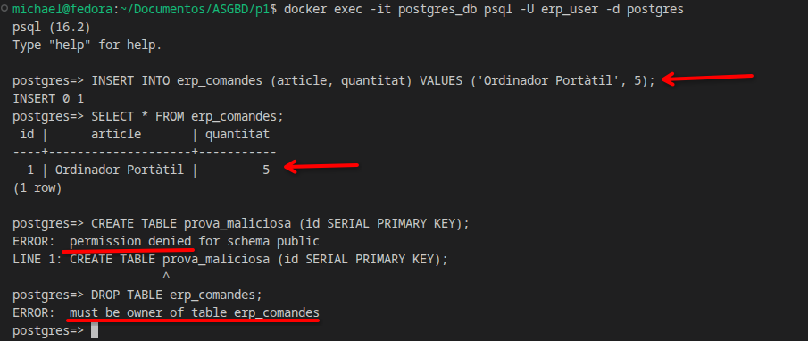


Para comprobar que rechaza la conexión cuando llega al máximo de conexiones, modificamos el rol erp_user para que el máximo de conexiones sean dos: ALTER ROLE erp_user CONNECTION LIMIT 2;

Comprobamos que nos da el error al abrir la tercera terminal:

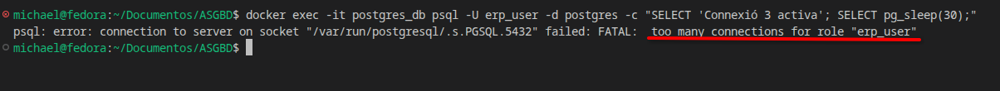

---

### 3.8. Gestión de usuarios y roles (Personal y Analistas)

Para cumplir con cuentas individuales, caducidad de 90 días y un modelo en el que las altas y bajas no requieran revisar privilegios de forma manual:

1. **Roles colectivos y vistas:**
El analista accede a través de la vista `vista_empleats_sense_salari` en `03-dades-prova.sql`, lo cual le permite ver los datos generales pero le deniega cualquier acceso a la columna de salarios de la tabla base.

```sql
CREATE VIEW vista_empleats_sense_salari AS SELECT id, nom, departament FROM empleats;
GRANT SELECT ON vista_empleats_sense_salari TO rol_analistes;
GRANT SELECT, INSERT, UPDATE, DELETE ON TABLE empleats TO rol_rrhh;
```

Comprobamos que un analista puede ver solo los datos de los empleados sin el salario.

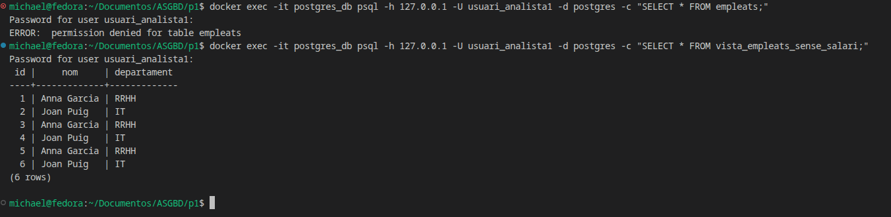

---
\
2. **Función de automatización de usuarios:**
Al incorporar un nuevo analista, basta con asignarle el rol colectivo correspondiente para otorgarle automáticamente los mismos permisos, sin necesidad de configurar privilegios de tabla uno a uno.

Creando la función `afegir_personal`, nos aseguramos de que los usuarios tengan una duración de 90 días y se asignen directamente a su grupo:

```sql
CREATE OR REPLACE FUNCTION afegir_personal(p_usuari TEXT, p_password TEXT, p_rol TEXT)
RETURNS VOID AS $$ DECLARE v_caducitat TIMESTAMP := CURRENT_TIMESTAMP + INTERVAL '90 days'; BEGIN EXECUTE format('CREATE USER \%I PASSWORD \%L VALID UNTIL \%L', p_usuari, p_password, v_caducitat); EXECUTE format('GRANT \%I TO \%I', p_rol, p_usuari); END; $$ LANGUAGE plpgsql;
```
\
Creamos el usuario nou_analista y le añadimos el rol analistes. Después, comprobamos que tiene todos los permisos:

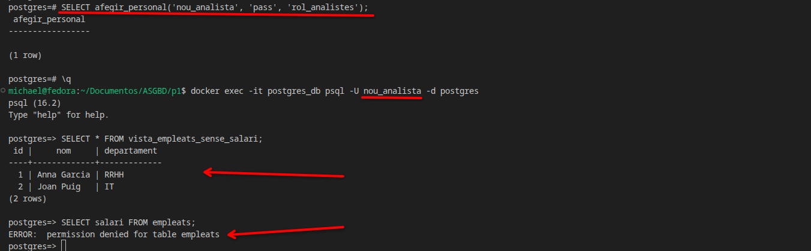

---
\
3. **Gestión de altas y bajas:**
Cuando el analista deja de formar part de la empresa, retirarle el rol colectivo supone la pérdida inmediata de todos los privilegios de acceso.

- **Alta:** `SELECT afegir_personal('nou_analista', 'pass', 'rol_analistes');`
- **Baja:** `REVOKE rol_analistes FROM nou_analista;`

Quitamos el rol a `nou_analista` y comprobamos que deja de poder acceder a la vista de empleados:

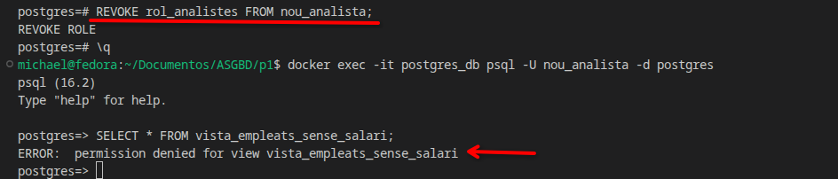

---

### 3.9 Ampliación: Caída repentina
- El servicio está configurado en el archivo `docker-compose.yml` con `restart: always`, lo cual garantiza que si el proceso o el contenedor cae de manera imprevista (fallo eléctrico o error crítico), Docker se encarga de levantarlo de nuevo de forma automática.

Realizaremos dos transacciones: una con su `COMMIT` finalizado y otra sin finalizar. A continuación, simularemos una caída repentina utilizando un `kill` del contenedor y, tras volver a arrancar el servicio, comprobaremos que la transacción confirmada se ha guardado correctamente y la otra se ha descartado.

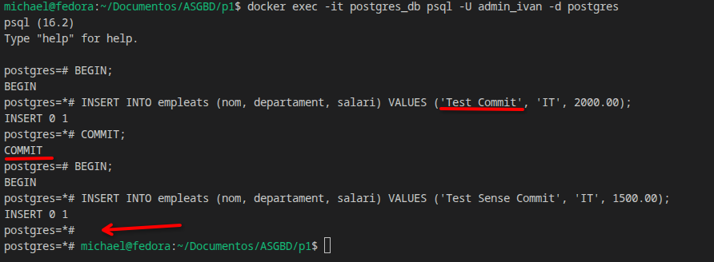

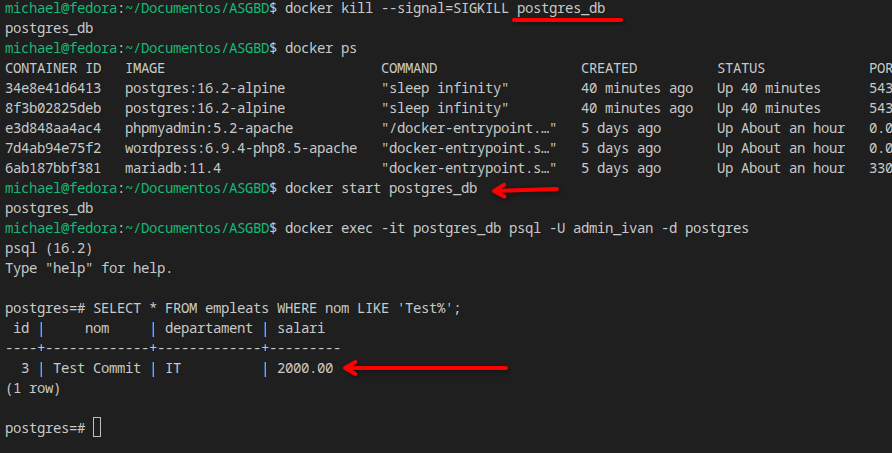

- PostgreSQL permite mejorar el rendimiento de las escrituras relajando la sincronización del disco mediante el parámetro `synchronous_commit`. Si se configura en `off`, el servidor confirma la transacción al usuario antes de que los cambios se hayan escrito físicamente en el disco (en el área de registro WAL), priorizando la velocidad frente a la durabilidad estricta ante fallos de hardware extremos.

